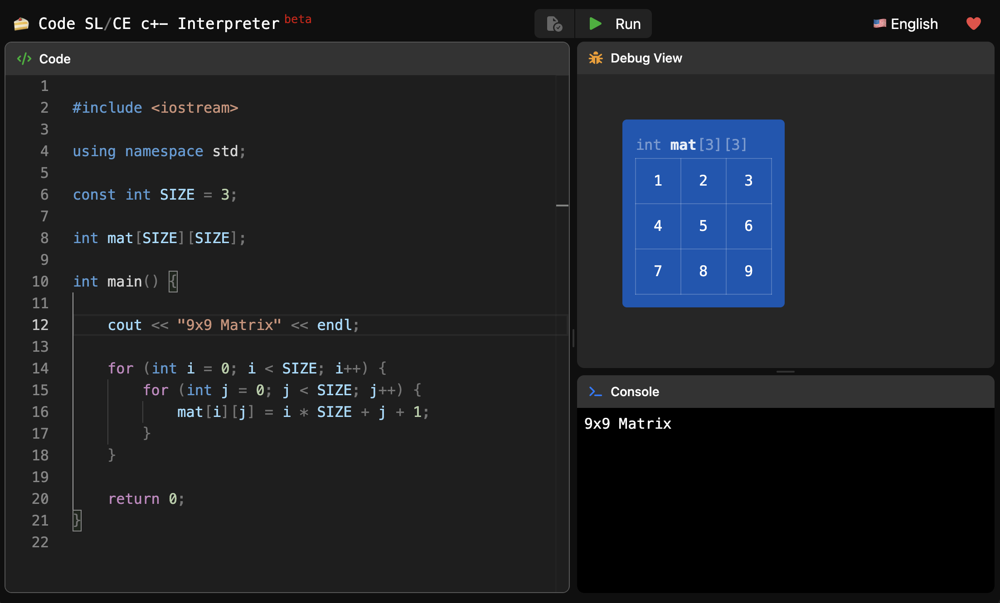

# Code SL/CE

Web interpreter for `c+-`, made with ❤️ to help students.\
https://cristian-5.github.io/codeslice/

### c+\-

The language `c+-` is a dialect of `c++` with some minor differences:

- Simpler execution / compilation errors.
- Dynamic type checking instead of static.
- The only available data types are `int`, `float`, `char`, `bool` and `string`.
- There are no pointers, classes, exceptions or objects.
- Precedence of compound operators (`+=`, `-=`, `*=`, `/=`, `%=`) is the same.

## Features

- [x] Lexing and Parsing
- [x] Better Syntax Errors
- [x] Variable Declaration
- [x] Multiple Declarations
- [x] Variable Assignment
- [x] Scope Shadowing
- [x] Expressions
- [x] `if` Statements
- [x] `cin`, `cout` Statements
- [x] Function Calls
- [x] Array, Matrix Declarations
- [x] Array, Matrix Subscript
- [x] `while`, `do while` Cycles
- [x] `break`, `continue` Statements
- [x] `for` Cycles
- [x] `++`, `--` Operators
- [x] Direct `cin` of Array Elements
- [x] `return` Statements
- [x] Function Declarations
- [x] `#include` Statements
- [x] `using namespace` Statements
- [x] Namespaces
- [x] `const` Keyword and Expressions
- [x] `+=`, `-=`, `*=`, `/=`, `%=` Operators
- [x] `switch` Statements
- [x] Automatic Type Casting
- [x] Random Number Generation
- [x] Variable Scoping view (dashed box per scope in the debug view)
- [x] Merge double scoped for loops in the debug view
- [x] Fix `char` arrays / matrices not showing `'`
- [x] `system("pause")`, `system("cls")`
- [x] `cin.get()`, `cin.get(c)` (e.g. "press Enter to continue")
- [x] `getline(cin, s)`, `getline(cin, s, delim)`
- [x] `cin.ignore()`, `cin.ignore(n)`, `cin.ignore(n, delim)`
- [x] Input behaves like the standard input of C++: `cin >> s` reads one word and leaves the `'\n'` in the buffer
- [x] Array, Matrix initializers (`int a[3] = {1, 2, 3};`, `int m[2][2] = {{1, 2}, {3, 4}};`, `int a[] = {1, 2};`, missing elements are zero, works with `const`)
